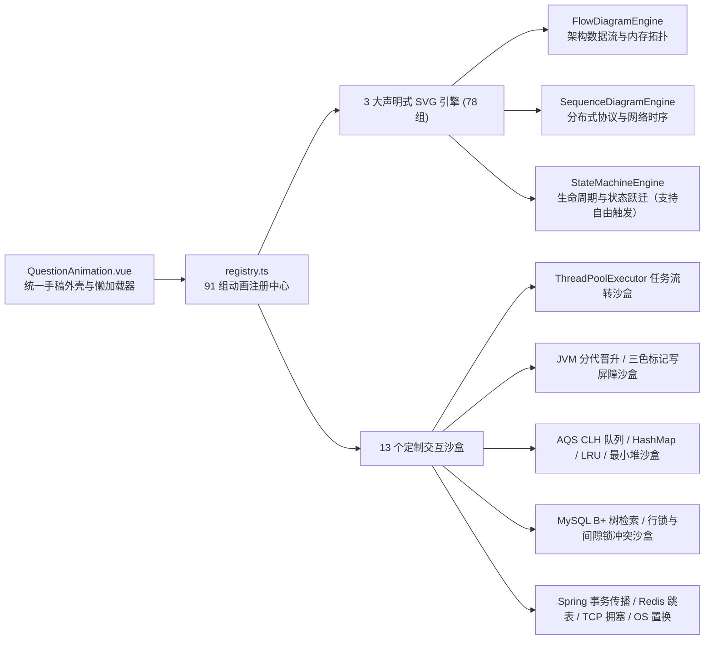
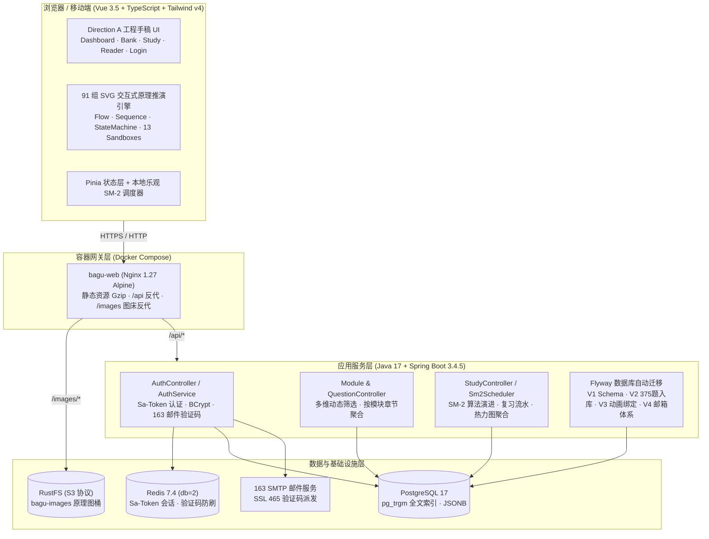

<div align="center">


# Bagu Lab · Java 后端工程记忆手稿

**把底层原理拆解成可交互的状态机，用 SM-2 间隔重复算法真正刻进肌肉记忆。**

[](https://openjdk.org/projects/jdk/17/)
[](https://spring.io/projects/spring-boot)
[](https://vuejs.org/)
[](https://www.typescriptlang.org/)
[](https://tailwindcss.com/)
[](https://www.postgresql.org/)
[](https://redis.io/)

<p align="center">
  <b>09 卷核心专题</b> · <b>375 道分级真题</b> · <b>102 张高清架构图解</b> · <b>91 组交互式 SVG 原理推演</b>
</p>

</div>

---

## 一、为什么做 Bagu Lab？

传统的 Java 后端八股复习往往困在两个极端：**要么面对几万字的静态 Markdown / PDF 走马观花，合上文档大脑一片空白；要么死记硬背孤立结论，面试官追问一句状态流转就卡壳。**

**Bagu Lab** 将认知心理学中的 **主动回忆（Active Recall）+ SM-2 间隔重复算法** 与 **交互式底层原理推演引擎** 融为一体：

1. **先理解机制，再记忆话术**：将 JVM 垃圾回收、AQS 同步队列、HashMap 扩容与红黑树化、MySQL B+ 树分裂与行锁矩阵、Spring 事务传播、TCP 拥塞控制等抽象过程做成 **91 组可单步推演、可自由触发的 SVG 交互动画**，每一步均配套「面试官标准口述话术」与「高频追问避坑提示」。
2. **科学对抗遗忘曲线**：基于 SuperMemo SM-2 算法，根据每次回忆自评（`1 完全不会` · `2 有点模糊` · `3 基本掌握` · `4 秒杀跳过`）动态演进单题易度因子 $EF$ 与复习间隔，自动编排每日到期队列。
3. **《精密工程手稿 · Engineering Monograph》视觉体系**：摒弃千篇一律的 AI 蓝紫渐变与悬浮发光球，汲取 O'Reilly 经典工程手稿、Linear 精密工具与 Dieter Rams 仪器面板美学——暖调档案纸（`#F7F6F2`）与深石墨（`#111110`）双模式、陶土朱砂（`#C84B31`）与鼠尾草绿（`#2E6F5E`）语义色、自托管 `JetBrains Mono` 等宽字体与 1px 细线账本结构，全站通过 WCAG AA 无障碍对比度检测。

---

## 二、五大核心特性

### 1. 91 组交互式底层原理推演（3 大声明式引擎 + 13 个动手实验沙盒）

覆盖全站 **112 道**核心原理题（其中 **85 道 P0 必背题**全部配备交互动画），采用「3 大通用 SVG 渲染引擎 + 13 个定制交互沙盒 + 按模块懒加载数据包」架构：



- **13 个可自由操纵的动手实验沙盒**：
  - `ThreadPoolFlow`：亲自点击「提交新任务」与「完成任务」，实时观察核心线程、阻塞队列、非核心救急线程与 `AbortPolicy` 拒绝策略的触发边界。
  - `JvmGenerationalGc` & `JvmTriColorGc`：动态模拟 Eden / Survivor `S0/S1` 复制交换、老年代晋升担保，以及三色标记法下「增量更新 vs 原始快照 (SATB)」拦截漏标的全过程。
  - `JucAqsQueue`：可视化 `state` CAS 抢锁、`exclusiveOwnerThread` 变更、CLH 双向队列入队挂起与前驱 `ws=-1 (SIGNAL)` 唤醒链。
  - `ColHashMapSandbox` / `ColLruSandbox` / `ColPriorityQueueSandbox`：演示 `put` 哈希寻址、拉链转红黑树阈值（`8 & 64`）、高低位链表 `e.hash & oldCap` 扩容拆分、LRU 双向链表头插淘汰与二叉最小堆上浮下沉。
  - `MysqlBPlusLookup` & `MysqlLocksSandbox`：对比 3 层 B+ 树聚簇索引 vs 二级索引回表 I/O 路径；交互式演示 RC / RR 隔离级别下 Record Lock、Gap Lock 与 Next-Key Lock 的锁定的区间与阻塞矩阵。
  - `SpringTxSandbox` / `RedisSkipListSandbox` / `NetTcpCongestion` / `OsPageReplacement`：覆盖 Spring 7 大事务传播行为异常回滚边界、ZSet 多层跳表折半查找、TCP 慢启动/拥塞避免/快重传 `cwnd` 曲线，以及 FIFO / LRU / Clock 页面置换命中率对比。

---

### 2. 四维一体化记忆工作流

| 核心工作台 | 路由 | 设计定位与交互亮点 |
| :--- | :--- | :--- |
| **学习调度仪表盘** | `/` | **今日 SM-2 调度台 + 四栏细线指标账本 + 九卷掌握度矩阵 + 12 周打卡热力图**。一屏掌控今日待复习、新题配额、总掌握率、P0 攻坚进度与考频分布，支持移动端点击热力图格子查看单日刷题明细。 |
| **多维题库账本** | `/bank` | **掌握状态 5 段筛选条**（`全部 / 未背 / 待巩固 / 复习中 / 已掌握`）+ **内容特征标签**（`已收藏 / 有助记 / 有动画`）+ **P0/P1/P2 考频多选** + **关键词防抖检索**。所有筛选状态与 URL Query 双向实时同步，进出题目绝不丢失页码与筛选上下文；支持「一键刷当前筛选出的 $N$ 道题」。 |
| **全键盘沉浸闪卡** | `/study` | **主动回忆 → 关键词提示 (`H`) → 揭晓答案 (`Space`) → 交互推演 → 个人助记批注 (`N`) → 四级评分 (`1~4`)**。内置 **6 秒评分撤销 (`Z`)** 防止手误、中途退出防误触保护，以及结算页 **「本轮薄弱题复盘清单 + 一键回炉重刷」**。 |
| **连续工程手稿通读** | `/read/:slug` | 还原纸质技术专著的连续章节阅读体验。顶部吸顶工具栏支持 **「仅看 P0 必背」**、**「隐藏答案自测」** 与 **「展开全部动画」**；题目内嵌动画默认采用**按需单行折叠抽屉**，兼顾长文秒开性能与深度交互推演；右侧配备 `IntersectionObserver` 实时跟随目录。 |

---

### 3. 全键盘极速快捷键体系

在 `/study` 闪卡工作台中，双手无需离开键盘即可完成全流程刷题：

| 快捷键 | 功能说明 | 快捷键 | 功能说明 |
| :---: | :--- | :---: | :--- |
| <kbd>Space</kbd> / <kbd>Enter</kbd> | 展开 / 收起参考答案与解析 | <kbd>1</kbd> <kbd>2</kbd> <kbd>3</kbd> <kbd>4</kbd> | SM-2 四级记忆自评并自动切下一题 |
| <kbd>Z</kbd> | **撤销上一题评分**（回到上一题重新评估） | <kbd>H</kbd> | 展开 / 隐藏卡壳关键词提示（Hints） |
| <kbd>S</kbd> | 收藏 / 取消收藏当前题目 | <kbd>N</kbd> | 聚焦「我的口述助记 / 面试追问备注」输入框 |
| <kbd>I</kbd> | 呼出高清原理图灯箱（支持滚轮缩放/拖拽） | <kbd>←</kbd> / <kbd>→</kbd> | 前后切换当前队列中的闪卡 |
| <kbd>?</kbd> | 打开快捷键速查面板 | <kbd>Esc</kbd> | 关闭灯箱/弹窗，或带确认保护退出闪卡 |

---

### 4. 九大核心知识卷目全览

| 卷号 | 模块代号 (`slug`) | 专题名称 | 题目数 | P0 必背 | 架构图解 | 交互式原理推演亮点 |
| :---: | :--- | :--- | :---: | :---: | :---: | :--- |
| `01` | `01-jvm` | **JVM 虚拟机** | 40 | 18 | 19 | 类加载双亲委派、运行时数据区、分代 GC 沙盒、三色标记沙盒、G1/ZGC |
| `02` | `02-concurrency` | **Java 并发编程** | 54 | 25 | 23 | 线程池 6 步+沙盒、AQS CLH 同步队列沙盒、synchronized 锁升级、JMM 内存屏障、ThreadLocal |
| `03` | `03-java-basics` | **Java 基础与集合** | 53 | 22 | 6 | HashMap 扩容与树化沙盒、LRU 缓存沙盒、PriorityQueue 最小堆沙盒、ConcurrentHashMap |
| `04` | `04-spring-mybatis` | **Spring 与 MyBatis** | 44 | 18 | 10 | Spring 事务传播沙盒、三级缓存破循环依赖、Bean 生命周期、Spring MVC 执行链、MyBatis 两级缓存 |
| `05` | `05-mysql` | **MySQL 数据库** | 49 | 24 | 7 | B+ 树聚簇/回表检索沙盒、行锁/间隙锁/临键锁冲突沙盒、MVCC ReadView、Redo/Undo/Binlog 两阶段提交 |
| `06` | `06-redis` | **Redis 缓存架构** | 39 | 21 | 15 | ZSet 跳表多层检索沙盒、穿透/击穿/雪崩防线、RDB/AOF 持久化、主从复制与 Sentinel/Cluster、分布式锁 |
| `07` | `07-design-patterns` | **设计模式** | 19 | 6 | 0 | 单例 DCL 指令重排、工厂/建造者、代理模式、责任链、观察者、策略与模板方法 |
| `08` | `08-network` | **计算机网络** | 43 | 17 | 11 | TCP 三次握手/四次挥手状态机、TCP 拥塞控制 `cwnd` 沙盒、HTTPS TLS 握手、DNS 递归/迭代解析、HTTP/1.1~3 |
| `09` | `09-os` | **操作系统** | 34 | 12 | 11 | 页面置换算法 (FIFO/LRU/Clock) 沙盒、进程五态转换状态机、虚拟内存页表转换、`select/poll/epoll`、零拷贝 |
| **合计** | — | **9 大核心专题** | **375** | **163** | **102** | **91 组交互动画（覆盖 112 题）** |

---

### 5. 邮箱验证码注册与多端云同步架构

- **邮箱 + 密码唯一凭证体系**：集成 163 SMTP 邮件服务与 Redis 多重防刷防爆破机制（60 秒发送冷却锁、单 IP 每日配额、5 分钟验证码 TTL、5 次输错自动销毁），支持 **邮箱验证码注册（自动签发 Token 直达工作台）**、**邮箱+密码登录** 与 **邮箱验证码重置密码**；`username` 独立用于顶栏手稿铭牌头像展示。
- **Sa-Token + Redis 分布式会话**：支持桌面端与手机端同时在线（`is-concurrent: true`），背诵进度、收藏夹、个人助记笔记与打卡热力图跨端毫秒级同步。

---

## 三、系统架构与技术栈



### 技术选型明细

| 层级 | 核心技术 | 关键工程实践 |
| :--- | :--- | :--- |
| **前端框架** | Vue 3.5 (`<script setup>`) + TypeScript 6.0 + Vite 8 | 路由级与动画数据包级按需 Code Splitting，生产全量构建 `< 1s` |
| **样式与设计系统** | Tailwind CSS v4 (`@theme`) + 自托管 `JetBrains Mono` | 语义化 CSS 变量亮暗双主题、零外部字体 CDN 阻塞、`impeccable detect` 零告警 |
| **Markdown 与高亮** | `markdown-it` + `highlight.js`（按需注册 6 种后端语言） | 代码块一键复制、表格横向滚动包裹、原理图异步解码 (`decoding="async"`) 与无障碍灯箱 |
| **后端核心** | Spring Boot 3.4.5 + MyBatis-Plus 3.5 + Java 17 | 统一 `Result<T>` 响应封装、全局异常拦截、Jakarta Validation 参数校验 |
| **认证与邮件** | Sa-Token (`sa-token-redis-jackson`) + `spring-security-crypto` + `spring-boot-starter-mail` | `BCrypt` 密码哈希、Redis 会话持久化、163 SMTP 手稿风 HTML 验证码邮件 |
| **数据存储** | PostgreSQL 17 + Flyway + Redis 7.4 + RustFS (AWS S3 SDK v2) | `pg_trgm` GIN 索引加速题干检索、`JSONB` 存储提示词与图解元数据、Flyway `V1~V4` 零人工迁移 |
| **CI/CD 交付** | GitHub Actions (`deploy.yml`) + Docker Compose + Nginx | 自动识别 `frontend/`、`backend/`、`deploy/` 变更路径，按需增量构建并通过 SSH 零停机发布 |

---

## 四、项目目录结构

```text
Bagu-lab/
├── .github/workflows/
│   └── deploy.yml                          # GitHub Actions 增量构建与云端自动部署流水线
├── backend/                                # Spring Boot 3.4 后端工程 (Java 17)
│   ├── pom.xml
│   └── src/main/
│       ├── java/com/bagu/
│       │   ├── common/                     # 统一响应 Result、PageResult、错误码与全局异常处理
│       │   ├── config/                     # Sa-Token、Redis、MyBatis-Plus、RustFS、OpenAPI 配置
│       │   ├── controller/                 # Auth / Module / Question / Study 四大 REST 控制器
│       │   ├── dto/                        # 登录/注册/验证码、题库查询、SM-2 复习请求与响应 VO
│       │   ├── entity/                     # 6 张核心表实体 (SysUser, KbModule, KbQuestion 等)
│       │   ├── mapper/                     # MyBatis-Plus Mapper 接口
│       │   └── service/                    # 核心业务实现与 Sm2Scheduler 算法调度器
│       └── resources/
│           ├── application.yml             # 核心配置（支持环境变量覆盖与 163 邮箱 SMTP）
│           ├── mapper/KbQuestionMapper.xml # 多条件动态筛选与掌握状态联合查询 SQL
│           └── db/migration/               # Flyway 自动迁移脚本
│               ├── V1__init_schema.sql                 # 6 张核心表与 GIN/部分索引定义
│               ├── V2__seed_knowledge_data.sql         # 9 大模块、375 道真题与 102 张图解种子数据
│               ├── V3__bind_all_question_animations.sql# 91 组交互动画与 112 道题目的映射绑定
│               └── V4__add_user_email.sql              # 邮箱登录体系与大小写不敏感唯一索引
├── frontend/                               # Vue 3.5 + TypeScript + Tailwind CSS v4 前端工程
│   ├── index.html
│   └── src/
│       ├── assets/fonts/                   # 自托管 JetBrains Mono 可变字体 (woff2)
│       ├── api/                            # Axios 拦截器与 REST API 模块化封装
│       ├── stores/                         # Pinia 状态管理 (auth.ts / ui.ts 模块缓存与主题同步)
│       ├── utils/                          # 前端 SM-2 预览计算器、Markdown 渲染引擎、时间格式化
│       ├── components/
│       │   ├── layout/AppShell.vue         # 桌面档案纸侧边栏 + 移动端 5 栏底部导航壳
│       │   ├── common/                     # ModuleIcon 编号章印、PriorityBadge、CheckinHeatmap、ImageLightbox 等
│       │   └── animations/                 # 91 组交互式原理动画核心目录
│       │       ├── QuestionAnimation.vue   # 统一手稿风外壳与动态加载器
│       │       ├── registry.ts             # 91 个动画 Key 的注册与懒加载分发
│       │       ├── engines/                # FlowDiagram / SequenceDiagram / StateMachine 三大 SVG 引擎
│       │       ├── sandboxes/              # 12 个专题交互沙盒 + ThreadPoolFlow.vue
│       │       └── data/                   # mod01Jvm.ts ~ mod09Os.ts 九大模块声明式动画规范
│       └── views/
│           ├── LoginView.vue               # 工程手稿规格铭牌 + 邮箱登录/验证码注册/找回密码一体台
│           ├── DashboardView.vue           # 今日 SM-2 调度台 + 四栏指标账本 + 九卷掌握矩阵
│           ├── BankView.vue                # 多维筛选题库账本（URL Query 双向同步）
│           ├── StudyView.vue               # 全键盘闪卡背诵工作台（含 Z 键撤销与薄弱题重刷）
│           └── ReaderView.vue              # 连续工程手稿通读页（按需展开动画 + 实时跟随目录）
├── deploy/
│   ├── docker-compose.yml                  # 生产容器编排 (bagu-api + bagu-web)
│   ├── nginx.conf                          # Nginx 静态托管与 /api、/images 反向代理配置
│   ├── deploy.ps1                          # 本地 PowerShell 一键构建与远程发布脚本
│   └── start-ssh-tunnel.ps1                # 本地开发连接远端 PG/Redis/RustFS 的 SSH 隧道脚本
└── scripts/
    └── docx_to_json.py                     # 原始 Word 八股笔记解析、图片上传 RustFS 与 SQL 生成流水线
```

---

## 五、快速开始

### 1. 本地开发联调

1. **开启数据库/缓存隧道（或使用本地 PostgreSQL 17 + Redis 7.4）**：
   ```powershell
   .\deploy\start-ssh-tunnel.ps1
   ```
2. **启动 Spring Boot 后端**（自动执行 Flyway `V1 ~ V4` 建表与 375 题入库，端口 `8080`）：
   ```powershell
   cd backend
   .\mvnw.cmd spring-boot:run
   ```
3. **启动 Vue 3 前端开发服**（Vite 自动将 `/api` 与 `/images` 代理至后端，端口 `5173`）：
   ```powershell
   cd frontend
   npm install
   npm run dev
   ```

### 2. 自动化生产部署（GitHub Actions）

项目已配置 [.github/workflows/deploy.yml](.github/workflows/deploy.yml)：
- 当向 `master` 分支执行 `git push` 时，工作流会自动对比变更目录：
  - 若 `frontend/` 变动 → 自动执行 `npm ci && npm run build` 并热同步至云端 `/opt/bagu/dist`（零停机立即生效）；
  - 若 `backend/` 变动 → 自动执行 `./mvnw clean package -DskipTests`、备份旧 JAR、重启 `bagu-api` 容器（自动运行新增的 Flyway SQL 迁移）并执行 8080 端口健康探活；
  - 若 `deploy/` 变动 → 自动同步 `docker-compose.yml` 与 `nginx.conf` 并平滑重载 Nginx。
