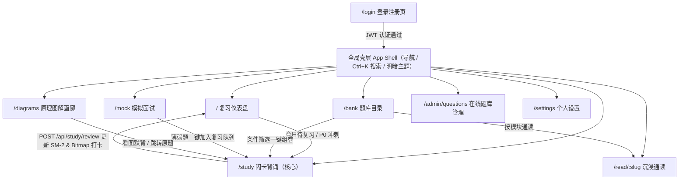

# 前端页面完整设计方案（前后端分离版）

> 本方案基于 [d:/八股](file:///d:/八股) 中已有的 **9 份 Java 后端面试复习笔记**，并面向**前后端分离 + 多端云同步（PostgreSQL 17 + Redis 7.4）**架构进行完整设计，兼顾 **PC 端全键盘极速刷题** 与 **手机端通勤碎片化背诵**。

---

## 一、内容资产盘点与设计定位

对原始 9 份 `.docx` 笔记进行结构化扫描后，前端需围绕以下内容特征做专项体验优化：

| 维度 | 现状特征 | 对应的前端专项设计 |
| :--- | :--- | :--- |
| **知识规模** | **9 大模块**（JVM、并发、基础集合、Spring/MyBatis、MySQL、Redis、设计模式、计网、OS），共约 **390+ 道核心题** | 9 模块能力盘点仪表盘 + 篇目级知识树导航 |
| **考频分级** | 原文自带三档考频：`【P0 必背】`（约 155 题）、`【P1 高频】`（约 123 题）、`【P2 了解】`（约 82 题） | **全站一等公民筛选器**，支持“考前只刷 P0 必背”一键冲刺模式 |
| **高清图解** | 共计 **103 张** 原理图/流程图（JDK 1.7/1.8 内存区、AQS、三色标记、CPU 飙高排障流程图等） | **灯箱无级缩放查看** + 专属 **「原理图解画廊」**（支持看图默背） |
| **对比表格** | 共计 **180+ 张** 结构化对比表（并发容器、锁升级、11 大设计模式速查等） | 定制高对比度斑马纹表格 + 移动端横向顺滑滚动阴影提示 |
| **代码实战** | 包含大量 Java / SQL / Redis / JVM 参数代码块 | 语法高亮 + 一键复制 + 行号展示 |
| **持续演进** | 面试复习期间会不断补充新面经题、修正口述要点 | 内置 **`/admin/questions` 在线 Markdown 编辑器 + 图床拖拽上传** |

### 核心设计原则
1. **主动回忆优先（Active Recall First）**：背诵态默认隐藏答案，先给题目 → 可选关键词提示 → 再展开完整答案，拒绝“看一遍以为自己会了”的假熟练。
2. **乐观更新零延迟（Optimistic UI）**：对接后端接口时，闪卡打分（`1~4`）、收藏、切题均先本地立即响应，后台异步落库 PostgreSQL，保持 0ms 丝滑刷题手感。
3. **双模式无缝共存**：同时支持 **“闪卡刷题模式”**（SM-2 抗遗忘）与 **“沉浸通读模式”**（系统复习 / 考前 30 分钟极速扫盲）。

---

## 二、信息架构与路由规划



### 完整路由表（9 个核心页面）

| 路由 | 页面名称 | 权限 | 核心定位 |
| :--- | :--- | :--- | :--- |
| `/login` | 登录与注册页 | 公开 | 极简卡片登录，支持个人私有模式（后端可开关注册） |
| `/` | 复习仪表盘（Dashboard） | 登录 | 今日待复习队列、P0 掌握度总览、9 大模块进度、Redis Bitmap 打卡热力图 |
| `/bank` | 题库目录（Knowledge Bank） | 登录 | 按模块/篇目/考频/掌握度精准检索，支持筛选结果一键组卷刷题 |
| `/study` | 闪卡背诵（Flashcard） | 登录 | 主动回忆、Hint 提示、富文本答案、SM-2 自评与全键盘快捷键刷题 |
| `/read/:slug` | 沉浸通读（Reader Mode） | 登录 | 连续阅读整篇笔记，支持「全局折叠答案自测」与「仅看 P0 必背」 |
| `/mock` | 模拟面试（Mock Interview） | 登录 | 按模块与考频权重随机抽题 + 倒计时口述 + 复盘报告与历史记录 |
| `/diagrams` | 原理图解画廊（Diagrams） | 登录 | 聚合 103 张高清原理图解，支持分类浏览与「看图反推知识点」 |
| `/admin/questions` | 在线题库管理与编辑页 | ADMIN | 双栏 Markdown 编辑器、拖拽传图到 RustFS/图床、编辑 P0/P1/P2 与 Hint |
| `/settings` | 个人与系统设置 | 登录 | 修改每日复习目标、账号密码、主题偏好、数据导出备份 |

---

## 三、视觉设计系统（Design System）

### 1. 色彩规范（护眼纸感浅色 + 深夜专注深色）

| 语义角色 | 浅色模式（Light） | 深色模式（Dark） | 使用场景 |
| :--- | :--- | :--- | :--- |
| **页面底色** | `#F8FAFC` (Slate 50) | `#0B1120` (Deep Slate) | 全局背景，降低长时间阅读视觉疲劳 |
| **卡片表面** | `#FFFFFF` | `#111827` (Gray 900) | 题目卡片、模块卡片、弹窗、编辑器 |
| **边框分割** | `#E2E8F0` | `#1F2937` | 1px 极细卡片边框与表格线 |
| **主品牌色** | `#2563EB` (Royal Blue) | `#3B82F6` (Blue 500) | 主操作按钮、选中态、进度条 |
| **文字主/次** | `#0F172A` / `#475569` | `#F1F5F9` / `#94A3B8` | 标题、正文、次要元信息 |
| **🔴 P0 必背** | `#DC2626` (底 `#FEF2F2`) | `#F87171` (底 `#450A0A`) | 红色高频徽章、考前冲刺标识 |
| **🔵 P1 高频** | `#2563EB` (底 `#EFF6FF`) | `#60A5FA` (底 `#172554`) | 蓝色高频徽章 |
| **⚪ P2 了解** | `#64748B` (底 `#F1F5F9`) | `#94A3B8` (底 `#1E293B`) | 灰色了解徽章 |
| **自评四档色** | 不会 `#EF4444` · 模糊 `#F59E0B` · 掌握 `#10B981` · 秒杀 `#6366F1` | 同色系降饱和高亮 | 闪卡底部打分按钮 & 掌握度进度条 |

### 2. 字体与排版规范
- **正文字体**：`'Inter', 'PingFang SC', 'Microsoft YaHei', 'Noto Sans SC', sans-serif`
- **代码字体**：`'JetBrains Mono', 'Fira Code', Consolas, monospace`
- **阅读区约束**：答案区最大宽度 `780px` 居中，正文 `15.5px ~ 16px`，行高 `1.75`，段落间距 `12px`。
- **质感风格**：类 Linear / Notion 的克制知识库美学，圆角统一 `rounded-2xl (16px)` + `1px` 细边框 + 轻柔弥散阴影。

---

## 四、各核心页面布局与交互细则

### 0. 全局导航壳层（App Shell）
- **桌面端（`≥ 1024px`）**：左侧 `240px` 可折叠侧边栏 + 顶部极简栏（面包屑 + **`Ctrl + K` 全局搜索框** + 暗黑模式切换 + 用户头像菜单）。
- **移动端（`< 768px`）**：隐藏侧边栏，顶部紧凑栏 + **底部 4 个固定 Tab**（首页 / 题库 / 背诵 / 模拟），其余入口收进右上角抽屉菜单。

---

### 1. 登录页（`/login`）
- 极简居中卡片（Logo + 副标题“个人 Java 八股记忆引擎” + 用户名/密码表单 + 记住登录态）。
- 仅在后端开启 `app.auth.allow-register=true` 时显示注册切换入口，默认单用户私密使用。

---

### 2. 复习仪表盘（`/`）

```text
+-------------------------------------------------------------------------+
| [Logo] Bagu Lab                  [ 🔍 搜索题目/关键字  Ctrl+K ] [☀️/🌙] 👤|
+-----------------+-------------------------------------------------------+
| 📊 复习仪表盘   |  +-------------------------------------------------+  |
| 📚 题库目录     |  | 🔥 今日待复习：18 题  |  今日新题配额：10 题    |  |
| ⚡ 闪卡背诵     |  |    [ ▶ 开始今日复习 ]    [ 🚀 只刷 P0 必背 ]    |  |
| 📖 沉浸通读     |  +-------------------------------------------------+  |
| 🎯 模拟面试     |                                                       |
| 🖼️ 原理图解(103)|  [总掌握 142/392] [P0 掌握 98/155] [连续打卡 12天]    |
| ✏️ 题库管理     |                                                       |
| ⚙️ 个人设置     |  ── 9 大核心模块掌握度 ─────────────────────────────  |
|                 |  +---------------+ +---------------+ +---------------+ |
|                 |  | 01 JVM (64题) | | 02 并发 (48题)| | 03 基础(107题)| |
|                 |  | █████░░░ 62%  | | ██████░░ 75%  | | ███░░░░░ 38%  | |
|                 |  | P0: 18/24     | | P0: 19/22     | | P0: 12/29     | |
|                 |  | [刷题] [通读] | | [刷题] [通读] | | [刷题] [通读] | |
|                 |  +---------------+ +---------------+ +---------------+ |
|                 |  ... (04 Spring ~ 09 OS 共 9 张卡片)                  |
|                 |                                                       |
|                 |  ── 每日背诵热力图 (Redis Bitmap 驱动) ─────────────  |
|                 |  ▪ ▫ ■ ■ ▪ ■ ▫ ■ ■ ■ ...      [查看错题本 (14题) →]   |
+-----------------+-------------------------------------------------------+
```

---

### 3. 题库目录与检索页（`/bank`）

```text
+-------------------------------------------------------------------------+
| 考频：[全部 | 🔴P0必背 | 🔵P1高频 | ⚪P2了解]                           |
| 状态：[全部 | 未背 | 不会/模糊 | 已掌握 | ⭐收藏 | 📝有笔记] [▶ 刷这24题]|
+-----------------------+-------------------------------------------------+
| 01 JVM (64)           |  Q01  [🔴P0 必背]  JVM 运行时数据区包括哪些部分？ |
|  ├─ 第一篇 内存模型   |       🖼️ 2图  📊 1表   🟢已掌握 · 3天后复习     |
|  ├─ 第二篇 类加载     |  ─────────────────────────────────────────────  |
|  ├─ 第三篇 堆与GC算法 |  Q02  [🔴P0 必背]  程序计数器、虚拟机栈和本地... |
|  ├─ 第四篇 垃圾收集器 |       📝 有助记        🟡模糊 · 今日待复习      |
|  └─ 第五篇 线上排障   |  ─────────────────────────────────────────────  |
| 02 Java 并发 (48)     |  Q03  [🔵P1 高频]  一个 Java 方法从调用到返回... |
| ...                   |       🖼️ 1图           ⚪未背                   |
+-----------------------+-------------------------------------------------+
```

- 任意组合筛选后，点击右上角 **「▶ 刷当前筛选出的 N 题」** 直接构造刷题队列跳入 `/study`。

---

### 4. 核心闪卡背诵页（`/study`）⭐ 灵魂页面

进入后自动隐藏侧边栏，聚焦“思考 → 提示 → 核对 → 打分”。

#### 回忆态（答案折叠）→ 展开态 + 底部自评 Dock
```text
+-------------------------------------------------------------------------+
| [← 退出]   01 JVM · 第一篇 内存模型    进度 6 / 20 [████░░░░░░]  ⭐  ✏️  |
+-------------------------------------------------------------------------+
|                                                                         |
|      +-----------------------------------------------------------+      |
|      |  Q01   [🔴 P0 必背]   [JVM]   [上次：模糊 · 1天前]        |      |
|      |                                                           |      |
|      |  JVM 运行时数据区包括哪些部分？哪些区域是线程私有的？     |      |
|      |                                                           |      |
|      |  ┌─ 💡 关键词提示（按 H 展开/收起）────────────────────┐  |      |
|      |  │  • 线程私有(3)：程序计数器、虚拟机栈、本地方法栈    │  |      |
|      |  │  • 线程共享(2)：堆、方法区（永久代 → 元空间）       │  |      |
|      |  └─────────────────────────────────────────────────────┘  |      |
|      |                                                           |      |
|      |  [ 未展开时显示大按钮：👀 显示完整答案 (Space) ]          |      |
|      |  [ 展开后渲染：Markdown 正文 + 语法高亮代码 + 对比表格    |      |
|      |    + 原理图缩略图(点击/按I进入灯箱缩放) + 个人助记框(按N) ]|      |
|      +-----------------------------------------------------------+      |
|                                                                         |
+-------------------------------------------------------------------------+
|  [ 1 完全不会 ]    [ 2 有点模糊 ]    [ 3 基本掌握 ]    [ 4 秒杀跳过 ]   |
|    (10 分钟后)        (1 天后)          (4 天后)         (10 天后)      |
+-------------------------------------------------------------------------+
```

- 右上角提供 `✏️` 快捷入口：如果背诵时发现某处表述不准确或想补充面试官追问，可直接跳转到该题编辑态修改并即时生效。

#### 全键盘快捷键体系
| 按键 | 功能 |
| :--- | :--- |
| `Space` / `Enter` | 展开 / 收起完整答案 |
| `H` | 展开 / 收起「关键词提示（Hint）」 |
| `1` / `2` / `3` / `4` | 展开答案后：打分并**乐观更新**自动切下一题 |
| `S` | 收藏 / 取消收藏 |
| `N` | 聚焦编辑「个人助记备注」（失焦或 `Ctrl+Enter` 自动保存） |
| `I` | 打开当前题目原理图的灯箱缩放模式 |
| `←` / `→` | 上一题 / 跳过到下一题 |
| `Esc` | 关闭弹窗或退出闪卡 |

---

### 5. 沉浸通读与考前速查页（`/read/:slug`）
- **三栏布局**：左侧篇目与题号 TOC（滚动跟随高亮）+ 中间连贯阅读区 + 顶部吸顶冲刺工具栏。
- **考前冲刺两大开关**：
  - **「仅看 P0 必背」**：瞬间滤掉 P1/P2，整篇压成考前 30 分钟必背清单。
  - **「隐藏所有答案（自测模式）」**：全篇只露题干，卡壳的题单独点开核对。

---

### 6. 模拟面试页（`/mock`）
1. **组卷配置**：多选考查模块 + 快捷模板（如「一面高频 10 题」）、P0/P1/P2 抽题权重、单题倒计时开关（如 2 分钟/题）。
2. **面试进行态**：隐藏题号与篇目防提示，底部倒计时 + 自评（未答出 / 答出部分 / 完整清晰）。
3. **复盘报告 + 历史记录**：展示综合得分、各模块正确率柱状图、薄弱题一键重置为今日待复习，历史场次持久化在 PostgreSQL 中随时回看。

---

### 7. 原理图解画廊（`/diagrams`）
- 聚合全库 **103 张高清原理图**，支持按 9 大模块筛选、网格浏览。
- 点击进入全屏灯箱支持 **「看图默背模式」**：左侧高清放大图，右侧默认隐藏关联题干与核心答案，点击展开核对或一键跳转原题闪卡。

---

### 8. 在线题库管理页（`/admin/questions`）
- 左侧选择模块/篇目/新建题目，右侧配置表单（题号、`P0/P1/P2`、题干、Hint 列表）+ **左右分栏 Markdown 实时预览编辑器**。
- 支持 **Ctrl+V 粘贴截图 / 拖拽上传图片** → 自动调用 `POST /api/admin/upload/image` 存至图床并回填 Markdown 图片语法。
- 保存后后端同步更新 PostgreSQL 并自动失效对应 Redis 缓存。

---

### 9. 全局 `Ctrl + K` 命令搜索弹窗
- 任意页面按 `Ctrl + K` 唤出，防抖 `200ms` 请求后端 `GET /api/search?q=...`（由 PostgreSQL `pg_trgm` 索引支撑毫秒级中文模糊匹配）。
- 支持搜题号（`JVM Q09`）、搜关键词（`三色标记`、`MVCC`、`AQS`），方向键选择后 `Enter` 直达闪卡，`Shift + Enter` 直达通读定位。

---

## 五、移动端适配与 PWA 体验

- **单手拇指热区**：闪卡页的「显示答案」和 `1~4` 自评按钮固定在屏幕底部（适配 `env(safe-area-inset-bottom)`）。
- **图表友好**：180+ 对比表格外包 `overflow-x-auto` 容器并加边缘渐变提示；103 张原理图支持双指捏合放大。
- **PWA 桌面化**：配置 `manifest.json`，手机浏览器一键「添加到主屏幕」以全屏无地址栏模式运行。

---

## 六、前端工程架构与请求层设计（Vue 3 + Pinia + Tailwind CSS）

```text
D:\Java\Bagu\frontend\
├── public/
│   └── manifest.json
├── src/
│   ├── api/
│   │   ├── client.ts          # Axios 实例 + Sa-Token 请求头注入与 401 统一处理
│   │   ├── auth.ts
│   │   ├── knowledge.ts       # 模块 / 题库 / 通读 / 图解 / 搜索接口
│   │   ├── study.ts           # 仪表盘 / 刷题队列 / SM-2 打卡 / 收藏 / 笔记接口
│   │   ├── mock.ts            # 模拟面试接口
│   │   └── admin.ts           # 题目 CRUD & RustFS 图片上传接口
│   ├── components/
│   │   ├── layout/            # AppShell、Sidebar、MobileTabBar、CommandSearch
│   │   ├── markdown/          # AnswerRenderer（GFM 表格 / 代码高亮 / 灯箱图解）
│   │   └── flashcard/         # FlashcardCard、RatingDock、HintBox、NoteEditor
│   ├── views/                 # Login / Dashboard / Bank / Study / Reader / Mock / Diagrams / Admin / Settings
│   ├── router/                # Vue Router 路由配置与登录守卫
│   ├── stores/                # Pinia 状态（Auth、主题、刷题队列）
│   └── types/                 # 前后端对齐的 TypeScript 接口类型定义
└── package.json
```
