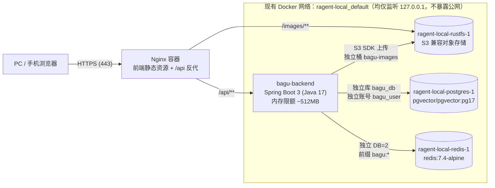
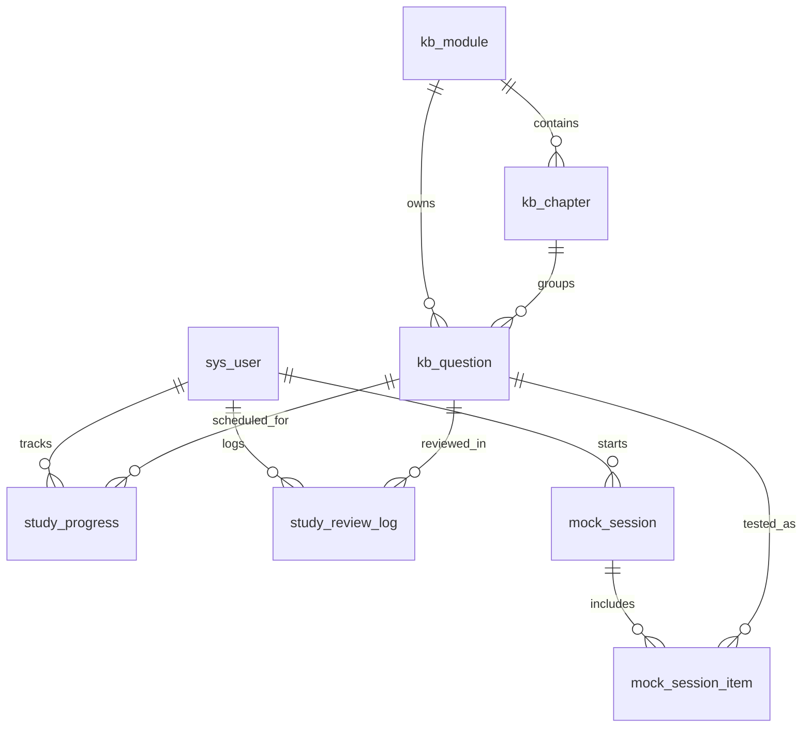
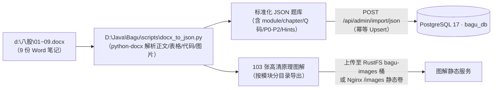

# 系统架构、方案 A 中间件规划与 PostgreSQL 17 数据库设计

> 本文档为 **Bagu Platform** 的后端与基础设施完整设计规范。采用 **方案 A（复用服务器 `59.110.124.170` 现有中间件并实现逻辑完全隔离）**，数据库全面采用 **PostgreSQL 17**。

---

## 一、总体架构（方案 A：复用现有 Docker 中间件）

服务器 `59.110.124.170`（Ubuntu 24.04 · 2C / 3.4G RAM / 36G 可用磁盘）已稳定运行一套 `ragent-local` Docker 容器组（位于外部网络 `ragent-local_default`）。为充分节省内存并保持高安全性，本项目的后端服务通过加入同一 Docker 网络实现**内网直连复用、数据完全隔离**：



### 方案 A 隔离与资源规划

| 中间件 | 服务器现有容器 | 本项目隔离策略 | 预计新增内存 |
| :--- | :--- | :--- | :--- |
| **PostgreSQL 17** | `ragent-local-postgres-1` (`127.0.0.1:5432`) | 新建独立角色 **`bagu_user`** + 独立数据库 **`bagu_db`**（不授予 `ragent` 库任何权限） | **~0 MB** |
| **Redis 7.4** | `ragent-local-redis-1` (`127.0.0.1:6379`) | 使用独立逻辑库 **`database = 2`** + 全局键前缀 **`bagu:`**（同时承载 Sa-Token 会话与业务缓存） | **~5 MB** |
| **RustFS 对象存储** | `ragent-local-rustfs-1` (`127.0.0.1:9000`) | 新建独立桶 **`bagu-images`**（配置匿名只读或由 Nginx 反代 `/images/**`），后端使用 AWS S3 SDK v2 上传与管理 | **~0 MB** |
| **应用服务** | 新增 `bagu-backend` + `bagu-nginx` | 部署在 `/opt/bagu`，通过 `docker-compose.yml` 接入外部网络 `ragent-local_default` | **~350~550 MB**（在当前 1.5G 可用内存中游刃有余） |

### 本地开发联调网络策略（安全零暴露）
- 服务器上的 PG (`5432`)、Redis (`6379`)、RustFS (`9000`) **继续保持仅监听 `127.0.0.1`，绝不暴露到公网**。
- 在 Windows 本机开发 Spring Boot 后端时，启动一条 **SSH 本地端口转发隧道** 即可像连本地一样安全连接服务器中间件：
  ```bash
  ssh -N -L 5432:127.0.0.1:5432 -L 6379:127.0.0.1:6379 -L 9000:127.0.0.1:9000 root@59.110.124.170
  ```

---

## 二、后端技术栈选型

| 模块 | 技术选型 | 说明 |
| :--- | :--- | :--- |
| **基础框架** | **Java 17 + Spring Boot 3.4.x** | 契合你本机已安装的 OpenJDK 17 |
| **持久层** | **MyBatis-Plus 3.5.x + PostgreSQL JDBC Driver** | 使用 `JacksonTypeHandler` 直接映射 PG `JSONB` 字段 |
| **缓存客户端** | **Spring Data Redis (Lettuce)** | 操作 Bitmap 打卡、Cache-Aside 缓存、Sa-Token 会话持久化 |
| **认证鉴权** | **Sa-Token (`sa-token-spring-boot3-starter` + `sa-token-redis-jackson`)** | 轻量高效、原生支持 Redis 会话存储、Token 自动续期、角色注解 `@SaCheckRole("ADMIN")` 与踢人下线 |
| **对象存储客户端** | **AWS S3 SDK v2**（适配 RustFS） | 将 103 张原始图解及后台新上传图片写入 RustFS `bagu-images` 桶 |
| **接口文档** | **SpringDoc OpenAPI 3 + Knife4j** | 自动产出在线可调试接口文档 |
| **数据库迁移** | **Flyway** | 管理 PostgreSQL Schema 版本演进（`db/migration/V1__init.sql`） |
| **参数校验与映射** | **Jakarta Validation + MapStruct / Lombok** | 统一请求校验与全局异常 `GlobalExceptionHandler` |

---

## 三、PostgreSQL 17 完整数据库设计（8 张核心表）

### ER 关系概览



### 1. 服务器端数据库与账号初始化脚本（待部署阶段执行）

```sql
-- 使用超级用户登录 ragent-local-postgres-1 后执行
CREATE USER bagu_user WITH PASSWORD '<STRONG_PG_PASSWORD>';
CREATE DATABASE bagu_db OWNER bagu_user ENCODING 'UTF8';

\c bagu_db
-- 开启模糊检索三元组扩展（支撑 Ctrl+K 毫秒级中文/英文模糊搜索）
CREATE EXTENSION IF NOT EXISTS pg_trgm;
-- 预留：如未来做 AI 语义检索/RAG，可直接开启 pgvector
-- CREATE EXTENSION IF NOT EXISTS vector;
```

### 2. 核心业务建表 DDL（PostgreSQL 17 规范）

```sql
-- ============================================================
-- 1. 用户表 sys_user
-- ============================================================
CREATE TABLE sys_user (
    id              BIGINT GENERATED BY DEFAULT AS IDENTITY PRIMARY KEY,
    username        VARCHAR(50)  NOT NULL UNIQUE,
    password_hash   VARCHAR(120) NOT NULL,
    nickname        VARCHAR(60)  NOT NULL DEFAULT '',
    role            VARCHAR(20)  NOT NULL DEFAULT 'USER' CHECK (role IN ('ADMIN', 'USER')),
    daily_goal      INT          NOT NULL DEFAULT 20 CHECK (daily_goal > 0),
    created_at      TIMESTAMPTZ  NOT NULL DEFAULT NOW(),
    updated_at      TIMESTAMPTZ  NOT NULL DEFAULT NOW()
);

COMMENT ON TABLE sys_user IS '系统用户表';

-- ============================================================
-- 2. 知识模块表 kb_module（对应 01 JVM ~ 09 操作系统）
-- ============================================================
CREATE TABLE kb_module (
    id              BIGINT GENERATED BY DEFAULT AS IDENTITY PRIMARY KEY,
    slug            VARCHAR(50)  NOT NULL UNIQUE,
    title           VARCHAR(64)  NOT NULL,
    full_title      VARCHAR(128) NOT NULL,
    description     TEXT         NOT NULL DEFAULT '',
    sprint_guide    TEXT         NOT NULL DEFAULT '',
    sort_order      INT          NOT NULL DEFAULT 0,
    created_at      TIMESTAMPTZ  NOT NULL DEFAULT NOW(),
    updated_at      TIMESTAMPTZ  NOT NULL DEFAULT NOW()
);

CREATE INDEX idx_kb_module_sort ON kb_module (sort_order);
COMMENT ON TABLE kb_module IS '八股知识模块表（9大核心专题）';

-- ============================================================
-- 3. 模块篇目表 kb_chapter
-- ============================================================
CREATE TABLE kb_chapter (
    id              BIGINT GENERATED BY DEFAULT AS IDENTITY PRIMARY KEY,
    module_id       BIGINT       NOT NULL REFERENCES kb_module(id) ON DELETE CASCADE,
    title           VARCHAR(160) NOT NULL,
    summary         TEXT         NOT NULL DEFAULT '',
    question_range  VARCHAR(40)  NOT NULL DEFAULT '',
    sort_order      INT          NOT NULL DEFAULT 0,
    created_at      TIMESTAMPTZ  NOT NULL DEFAULT NOW()
);

CREATE INDEX idx_kb_chapter_module_sort ON kb_chapter (module_id, sort_order);
COMMENT ON TABLE kb_chapter IS '模块内篇目/子章节表';

-- ============================================================
-- 4. 核心题目表 kb_question
-- ============================================================
CREATE TABLE kb_question (
    id              BIGINT GENERATED BY DEFAULT AS IDENTITY PRIMARY KEY,
    module_id       BIGINT       NOT NULL REFERENCES kb_module(id) ON DELETE CASCADE,
    chapter_id      BIGINT       REFERENCES kb_chapter(id) ON DELETE SET NULL,
    code            VARCHAR(24)  NOT NULL,              -- 如 Q01, DP01
    priority        VARCHAR(8)   NOT NULL DEFAULT 'P1' CHECK (priority IN ('P0', 'P1', 'P2')),
    title           VARCHAR(400) NOT NULL,
    hints_json      JSONB        NOT NULL DEFAULT '[]'::jsonb,
    answer_md       TEXT         NOT NULL,
    images_json     JSONB        NOT NULL DEFAULT '[]'::jsonb, -- [{"url":"...","caption":"..."}]
    tags_json       JSONB        NOT NULL DEFAULT '[]'::jsonb,
    has_table       BOOLEAN      NOT NULL DEFAULT FALSE,
    sort_order      INT          NOT NULL DEFAULT 0,
    is_deleted      BOOLEAN      NOT NULL DEFAULT FALSE,
    created_at      TIMESTAMPTZ  NOT NULL DEFAULT NOW(),
    updated_at      TIMESTAMPTZ  NOT NULL DEFAULT NOW(),
    CONSTRAINT uk_kb_question_module_code UNIQUE (module_id, code)
);

-- 高频组合筛选索引（按模块 + P0/P1/P2 + 排序）
CREATE INDEX idx_kb_question_filter ON kb_question (module_id, priority, sort_order) WHERE is_deleted = FALSE;
CREATE INDEX idx_kb_question_chapter ON kb_question (chapter_id, sort_order) WHERE is_deleted = FALSE;
-- PostgreSQL pg_trgm 三元组 GIN 索引：支撑 Ctrl+K 毫秒级模糊检索（中英文均生效）
CREATE INDEX idx_kb_question_title_trgm ON kb_question USING GIN (title gin_trgm_ops);
CREATE INDEX idx_kb_question_answer_trgm ON kb_question USING GIN (answer_md gin_trgm_ops);
-- JSONB GIN 索引：支撑按标签/图解存在性筛选
CREATE INDEX idx_kb_question_tags_gin ON kb_question USING GIN (tags_json);

COMMENT ON TABLE kb_question IS '八股核心题目表（含 P0/P1/P2 分级、Markdown 答案、JSONB 图解与提示）';

-- ============================================================
-- 5. 用户学习与 SM-2 复习进度表 study_progress
-- ============================================================
CREATE TABLE study_progress (
    id               BIGINT GENERATED BY DEFAULT AS IDENTITY PRIMARY KEY,
    user_id          BIGINT        NOT NULL REFERENCES sys_user(id) ON DELETE CASCADE,
    question_id      BIGINT        NOT NULL REFERENCES kb_question(id) ON DELETE CASCADE,
    status           SMALLINT      NOT NULL DEFAULT 0 CHECK (status IN (0, 1, 2, 3)), -- 0未背 1学习中 2复习中 3已掌握
    ease_factor      NUMERIC(4, 2) NOT NULL DEFAULT 2.50,
    interval_days    INT           NOT NULL DEFAULT 0,
    repetitions      INT           NOT NULL DEFAULT 0,
    lapse_count      INT           NOT NULL DEFAULT 0,   -- 遗忘/点“不会”的累计次数（用于定位高频错题）
    next_review_at   TIMESTAMPTZ,
    last_reviewed_at TIMESTAMPTZ,
    is_starred       BOOLEAN       NOT NULL DEFAULT FALSE,
    personal_note    TEXT          NOT NULL DEFAULT '',
    updated_at       TIMESTAMPTZ   NOT NULL DEFAULT NOW(),
    CONSTRAINT uk_study_progress_user_q UNIQUE (user_id, question_id)
);

-- 极速拉取“今日到期复习队列”
CREATE INDEX idx_study_progress_due ON study_progress (user_id, next_review_at) WHERE next_review_at IS NOT NULL;
-- 收藏夹与错题本筛选
CREATE INDEX idx_study_progress_star ON study_progress (user_id, is_starred) WHERE is_starred = TRUE;
CREATE INDEX idx_study_progress_status ON study_progress (user_id, status);

COMMENT ON TABLE study_progress IS '用户单题 SM-2 间隔重复进度、收藏与个人助记表';

-- ============================================================
-- 6. 刷题复习流水表 study_review_log
-- ============================================================
CREATE TABLE study_review_log (
    id              BIGINT GENERATED BY DEFAULT AS IDENTITY PRIMARY KEY,
    user_id         BIGINT      NOT NULL REFERENCES sys_user(id) ON DELETE CASCADE,
    question_id     BIGINT      NOT NULL REFERENCES kb_question(id) ON DELETE CASCADE,
    rating          SMALLINT    NOT NULL CHECK (rating IN (1, 2, 3, 4)), -- 1不会 2模糊 3掌握 4秒杀
    duration_sec    INT         NOT NULL DEFAULT 0,
    prev_interval   INT         NOT NULL DEFAULT 0,
    next_interval   INT         NOT NULL DEFAULT 0,
    reviewed_at     TIMESTAMPTZ NOT NULL DEFAULT NOW()
);

CREATE INDEX idx_study_log_user_time ON study_review_log (user_id, reviewed_at DESC);
COMMENT ON TABLE study_review_log IS '复习打分流水表（用于每日统计、热力图校验与学习曲线分析）';

-- ============================================================
-- 7. 模拟面试主表 mock_session
-- ============================================================
CREATE TABLE mock_session (
    id              BIGINT GENERATED BY DEFAULT AS IDENTITY PRIMARY KEY,
    user_id         BIGINT      NOT NULL REFERENCES sys_user(id) ON DELETE CASCADE,
    title           VARCHAR(100) NOT NULL DEFAULT '模拟面试',
    config_json     JSONB       NOT NULL DEFAULT '{}'::jsonb, -- {"moduleIds":[1,2],"weights":{"P0":70,"P1":25,"P2":5},"timerSec":120}
    total_count     INT         NOT NULL,
    total_score     NUMERIC(5,2),
    status          VARCHAR(20) NOT NULL DEFAULT 'IN_PROGRESS' CHECK (status IN ('IN_PROGRESS', 'COMPLETED', 'ABANDONED')),
    created_at      TIMESTAMPTZ NOT NULL DEFAULT NOW(),
    finished_at     TIMESTAMPTZ
);

CREATE INDEX idx_mock_session_user ON mock_session (user_id, created_at DESC);
COMMENT ON TABLE mock_session IS '模拟面试场次记录表';

-- ============================================================
-- 8. 模拟面试明细表 mock_session_item
-- ============================================================
CREATE TABLE mock_session_item (
    id              BIGINT GENERATED BY DEFAULT AS IDENTITY PRIMARY KEY,
    session_id      BIGINT      NOT NULL REFERENCES mock_session(id) ON DELETE CASCADE,
    question_id     BIGINT      NOT NULL REFERENCES kb_question(id) ON DELETE CASCADE,
    sort_order      INT         NOT NULL,
    self_score      SMALLINT    CHECK (self_score IN (0, 1, 2)), -- 0未答出 1答出部分 2完整清晰
    duration_sec    INT         NOT NULL DEFAULT 0,
    remark          TEXT        NOT NULL DEFAULT ''
);

CREATE INDEX idx_mock_item_session ON mock_session_item (session_id, sort_order);
COMMENT ON TABLE mock_session_item IS '模拟面试单题作答与自评明细表';
```

### 为什么 PostgreSQL 17 方案比 MySQL 更简洁强大？
1. **局部索引（Partial Index）**：如 `WHERE is_deleted = FALSE`、`WHERE is_starred = TRUE`，大幅缩小索引体积，精准命中热点查询。
2. **`pg_trgm` 中文模糊搜索**：不需要额外维护 ES 或分词插件，直接 `WHERE title ILIKE '%三色标记%'` 即可走 GIN 索引。
3. **严格约束 + 原生布尔/时区**：`CHECK` 约束、`BOOLEAN`、`TIMESTAMPTZ`、`JSONB` 全部原生支持，数据一致性更高。

---

## 四、Redis 7.4 Key 规划（独立 `database = 2` + `bagu:` 前缀）

| 业务场景 | Key 模板 | 数据结构 | TTL | 说明 |
| :--- | :--- | :--- | :--- | :--- |
| **每日打卡热力图** | `bagu:checkin:{userId}:{yyyyMM}` | `Bitmap` | 永久 | `SETBIT key (day-1) 1`，`BITCOUNT` 查月打卡、`BITFIELD` 算连续打卡天数 |
| **今日已刷题数** | `bagu:daily:cnt:{userId}:{yyyyMMdd}` | `String (INCR)` | 48h | 仪表盘实时展示“今日已完成 X / 20 题” |
| **9 大模块元信息缓存** | `bagu:modules:meta` | `String (JSON)` | 24h | 高频读取，后台增删改题时主动 `DEL` 失效（Cache-Aside） |
| **单题详情缓存** | `bagu:q:detail:{questionId}` | `String (JSON)` | 12h + 随机抖动 | 防缓存雪崩；后台编辑该题时删除对应 Key |
| **Sa-Token 会话与令牌** | `bagu:satoken:login:*` | `String / Hash` | 7d（活跃自动续期） | 由 Sa-Token 自动维护登录态、角色权限与踢人下线 |
| **接口防刷限流** | `bagu:rl:{api}:{ipOrUser}` | `String / ZSet` | 60s | 对登录、全文搜索接口做轻量级限流保护 |

---

## 五、核心 RESTful API 规范

### 统一响应包装格式
```json
{
  "code": 200,
  "message": "ok",
  "data": { ... },
  "timestamp": 1763790000000
}
```

### 接口总览

| 分组 | 方法与路径 | 说明 |
| :--- | :--- | :--- |
| **认证** | `POST /api/auth/login` | 登录，返回 Access Token + Refresh Token |
| | `POST /api/auth/refresh` | 刷新 Access Token |
| | `POST /api/auth/logout` | 注销并清理 Redis Refresh Token |
| | `GET /api/auth/me` | 获取当前用户信息与每日目标 |
| **题库与图解** | `GET /api/modules` | 获取 9 大模块统计与当前用户各模块总掌握度/P0 掌握度 |
| | `GET /api/modules/{slug}/reader` | 获取单模块沉浸通读全量数据（篇目树 + 题目列表 + 个人进度） |
| | `GET /api/questions` | 分页/条件查询（`moduleId`, `chapterId`, `priority`, `status`, `starred`, `hasNote`, `keyword`） |
| | `GET /api/questions/{id}` | 获取单题详情 + 个人进度/笔记 |
| | `GET /api/diagrams` | 获取 103 张高清原理图解列表（支持 `moduleId` 筛选，附带关联题号/标题） |
| | `GET /api/search?q=xxx&limit=20` | `Ctrl+K` 全局搜索（PG `pg_trgm` 索引驱动） |
| **背诵与 SM-2** | `GET /api/study/dashboard` | 仪表盘聚合（今日待复习数、P0 掌握率、近 90 天热力图、连续打卡天数） |
| | `GET /api/study/queue` | 拉取刷题队列（模式：`today` / `p0_sprint` / `mistakes` / `custom_filter`） |
| | `POST /api/study/review` | 提交打分（`questionId`, `rating: 1..4`, `durationSec`），更新 `study_progress` + 写流水 + Redis Bitmap 打卡 |
| | `PATCH /api/study/questions/{id}/star` | 切换收藏状态 |
| | `PUT /api/study/questions/{id}/note` | 保存/更新个人口述助记 |
| **模拟面试** | `POST /api/mock/sessions` | 按模块与考频权重随机抽题创建模拟面试 |
| | `POST /api/mock/sessions/{id}/submit` | 提交模拟面试各题自评并计算复盘报告 |
| | `GET /api/mock/sessions` | 历史模拟面试列表 |
| | `GET /api/mock/sessions/{id}` | 单场模拟面试详细复盘报告 |
| **在线题库管理** | `POST /api/admin/questions` | 新增题目 |
| | `PUT /api/admin/questions/{id}` | 编辑题目内容/考频/Hint 并清除对应 Redis 缓存 |
| | `DELETE /api/admin/questions/{id}` | 逻辑删除题目 |
| | `POST /api/admin/upload/image` | 上传原理图至 RustFS/图床并返回访问 URL |
| | `POST /api/admin/import/json` | 批量幂等导入（Upsert）由 `.docx` 解析脚本产出的标准 JSON |

---

## 六、现有 9 份 Word 笔记迁移入库流水线



- **特别兼容 `07 设计模式面试复习笔记.docx`**：其他 8 份文档采用 `Q01 【P0 必背】` 结构，而 `07 设计模式` 采用“11 种设计模式精讲（创建型/结构型/行为型）”结构，解析脚本会为其做专门适配（生成 `DP01` ~ `DP11` 卡片并标记合理考频），保证 9 个模块全部完整入库。

---

## 七、分阶段开发实施路线（待你确认启动后执行）

| 阶段 | 产出目标 | 涉及目录 |
| :--- | :--- | :--- |
| **Phase 1：数据与中间件就绪** | 1. 在服务器 PG17 初始化 `bagu_db` + `bagu_user` 并验证 Redis `db=2` 连通；<br>2. 编写 `scripts/docx_to_json.py`，完整解析 9 份 `.docx` 为 JSON + 103 张图解并人工抽检核对。 | `D:\Java\Bagu\scripts\` |
| **Phase 2：后端骨架与核心接口** | 1. 初始化 Spring Boot 3 + MyBatis-Plus + PG17 + Redis + Flyway 建表；<br>2. 完成 JWT 登录、题库批量导入、仪表盘统计、SM-2 刷题打卡、通读与全局搜索接口。 | `D:\Java\Bagu\backend\` |
| **Phase 3：前端核心闭环** | 1. 初始化 Vite + TS + Tailwind 前端工程；<br>2. 完成登录页、AppShell、仪表盘、题库目录、闪卡背诵（含快捷键与乐观更新）、沉浸通读与 `Ctrl+K` 搜索。 | `D:\Java\Bagu\frontend\` |
| **Phase 4：进阶功能与上线** | 1. 完成模拟面试、原理图解画廊（看图默背）、在线 Markdown 题库管理；<br>2. 编写 `deploy/docker-compose.yml` 与 `nginx.conf` 接入 `ragent-local_default`，绑定自定义域名并开启 HTTPS 上线。 | `D:\Java\Bagu\deploy\` |
