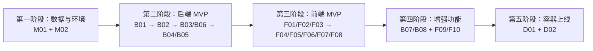

# 全栈开发模块清单（不含 AI 模块）

> 本文档列出 **Bagu Platform** 全部待开发模块（共 **4 大类 · 22 个子模块**），已剔除 AI 相关内容，严格聚焦「八股高效背诵、抗遗忘调度、模拟自测、图解记忆、在线维护」核心闭环。
>
> 优先级说明：**`[MVP 必做]`** 为第一版即可上线使用的核心闭环；**`[V1.1 增强]`** 为闭环跑通后立即补齐的进阶体验。

---

## 一、基础设施与数据迁移模块（2 个）

| 编号 | 模块名称 | 优先级 | 核心职责与交付物 | 落盘位置 |
| :--- | :--- | :--- | :--- | :--- |
| **M01** | **服务器中间件初始化（方案 A）** | MVP 必做 | 在 `59.110.124.170` 现有 PG17 中建 `bagu_db` + `bagu_user` + `pg_trgm` 扩展；确认 Redis `db=2` 与图解存储（RustFS `bagu-images` 桶或静态目录）；提供本机一键开启 SSH 隧道的脚本 | `deploy/` |
| **M02** | **Word 笔记结构化解析模块** | MVP 必做 | 编写 `docx_to_json.py`，解析 `d:\八股\01~09.docx`（同时兼容 `Qxx 【P0/P1/P2】` 与 `07 设计模式` 的 11 模式结构），输出标准 JSON（题干、考频、Hints、Markdown、表格、代码块）、导出 **103 张高清原理图** 及解析完整性报告 | `scripts/` |

---

## 二、后端业务模块（Spring Boot 3 + PG17 + Redis 7.4，共 8 个）

| 编号 | 模块名称 | 优先级 | 核心职责 | 关联数据表 / Redis |
| :--- | :--- | :--- | :--- | :--- |
| **B01** | **基础架构与公共模块** | MVP 必做 | 统一响应 `Result<T>`、全局异常处理、Flyway 自动建表（`V1__init.sql`）、MyBatis-Plus + PG `JSONB` TypeHandler、Redis 配置、CORS、Knife4j 接口文档 | 全部基础表 |
| **B02** | **认证与用户模块** | MVP 必做 | 登录/注销/刷新 Token（Access + Refresh 双 JWT）、BCrypt 密码加密、注册开关控制、用户信息查询与每日目标/密码修改 | `sys_user`、`bagu:auth:*` |
| **B03** | **知识库查询与检索模块** | MVP 必做 | 9 大模块与篇目树查询（Redis Cache-Aside 缓存）、多条件分页筛题、单题详情查询、整篇沉浸通读聚合接口、基于 PG `pg_trgm` 的 `Ctrl+K` 全局模糊检索 | `kb_module`、`kb_chapter`、`kb_question`、`bagu:modules:*`、`bagu:q:*` |
| **B04** | **闪卡背诵与 SM-2 调度模块** | MVP 必做 | 刷题队列生成（今日到期 / P0 冲刺 / 错题本 / 自定义条件）、SM-2 遗忘曲线算法（1~4 档自评更新 `interval_days`/`ease_factor`/`next_review_at`）、收藏、个人助记保存、刷题流水记录 | `study_progress`、`study_review_log` |
| **B05** | **仪表盘与打卡统计模块** | MVP 必做 | 仪表盘聚合接口：今日待复习数、总掌握度与 9 模块/P0 掌握度、Redis `Bitmap` 打卡写入、连续打卡天数与近 90 天热力图计算 | `study_progress`、`study_review_log`、`bagu:checkin:*`、`bagu:daily:*` |
| **B06** | **后台题库管理与导入模块** | MVP 必做 | 批量幂等导入（Upsert `M02` 产出的 JSON 题库）；在线新增/编辑/逻辑删除题目（自动失效 Redis 缓存）；图片上传接口（存 RustFS 或本地静态卷并返回 URL） | `kb_module`、`kb_chapter`、`kb_question` |
| **B07** | **模拟面试模块** | V1.1 增强 | 按模块与 `P0/P1/P2` 权重随机抽题建场、作答自评提交与综合算分、复盘报告与历史场次查询、未掌握题一键重置为今日待复习 | `mock_session`、`mock_session_item`、`study_progress` |
| **B08** | **原理图解聚合模块** | V1.1 增强 | 汇总全库 103 张原理图解（按模块过滤），携带图注与关联题目 ID/标题/考频，支撑图解画廊与「看图默背」 | `kb_question (images_json)` |

---

## 三、前端功能模块（Vite + TS + Tailwind，共 10 个）

| 编号 | 模块名称 | 优先级 | 对应路由 / 范围 | 核心功能点 |
| :--- | :--- | :--- | :--- | :--- |
| **F01** | **基础框架与全局壳层** | MVP 必做 | 全局 AppShell | 路由守卫、Axios JWT 自动续期拦截器、TanStack Query 封装、PC 可折叠侧边栏 + 移动端底部 4 Tab、浅色护眼/深色专注双主题切换 |
| **F02** | **登录与个人设置模块** | MVP 必做 | `/login`、`/settings` | 极简卡片登录、修改每日复习目标、修改密码、主题偏好与个人进度 JSON 导出备份 |
| **F03** | **通用富文本与图解组件** | MVP 必做 | 公共组件 | Markdown 渲染（GFM 斑马纹横向滚动表格、代码高亮+一键复制）、`P0/P1/P2` 语义徽章、103 张原理图点击灯箱缩放（支持移动端双指缩放） |
| **F04** | **复习仪表盘模块** | MVP 必做 | `/` | 今日待复习 & P0 极速冲刺横幅、核心 KPI 卡片、9 大模块进度卡（直达刷题/通读）、近 90 天打卡热力图、错题本快捷入口 |
| **F05** | **题库目录与筛选模块** | MVP 必做 | `/bank` | 左侧 9 模块+篇目树、右侧考频×掌握状态组合筛选、筛选结果一键生成刷题队列直达 `/study` |
| **F06** | **闪卡背诵核心模块** | MVP 必做 | `/study` | 沉浸回忆态（默认折叠答案 + `H` 关键词提示）、展开态（答案+图解+`N` 个人助记内联编辑）、底部 4 档 SM-2 自评 Dock、乐观更新 0ms 切题、全键盘快捷键与手机拇指热区适配 |
| **F07** | **沉浸通读与考前速查模块** | MVP 必做 | `/read/:slug` | 左侧篇目与题号 TOC 滚动高亮、「仅看 P0 必背」过滤开关、「全局折叠答案（自测模式）」开关 |
| **F08** | **全局 `Ctrl+K` 搜索模块** | MVP 必做 | 全局命令弹窗 | 防抖模糊搜题号/正文/设计模式、高亮命中片段、键盘 `↑/↓` 直达闪卡或通读定位 |
| **F09** | **在线题库编辑管理模块** | V1.1 增强 | `/admin/questions` | 双栏 Markdown 实时预览编辑器、粘贴/拖拽图片自动上传并插入链接、编辑 `P0/P1/P2` 标签与 Hint 列表 |
| **F10** | **模拟面试与图解画廊模块** | V1.1 增强 | `/mock`、`/diagrams` | 模拟面试组卷/倒计时/复盘报告/历史记录；103 张高清原理图瀑布流浏览与全屏「看图默背」模式 |

---

## 四、部署与运维模块（2 个）

| 编号 | 模块名称 | 优先级 | 核心职责与交付物 | 落盘位置 |
| :--- | :--- | :--- | :--- | :--- |
| **D01** | **Docker 容器化与 Nginx 反代** | MVP 必做 | 前后端 `Dockerfile`、`docker-compose.yml`（接入服务器 `ragent-local_default` 网络）、`nginx.conf`（前端 SPA 路由、`/api` 反向代理、静态图解代理、Gzip 压缩） | `deploy/` |
| **D02** | **域名 HTTPS 与数据定时备份** | V1.1 增强 | 绑定自定义域名与 HTTPS 证书自动续签、PWA `manifest.json` 手机桌面化、`bagu_db` 每日定时 `pg_dump` 备份脚本 | `deploy/` |

---

## 五、模块依赖与开发排期总览

> **MVP 最小可用里程碑（15 个模块）**：`M01~M02` + `B01~B06` + `F01~F08` + `D01` 完成后，即可在 PC 与手机上完整使用（登录同步、9 模块 390+ 题导入、仪表盘打卡、多维筛题、SM-2 闪卡背诵、P0 考前通读、`Ctrl+K` 全局搜索）。
>
> **V1.1 完整体验里程碑（补齐剩余 7 个模块）**：`B07~B08` + `F09~F10` + `D02` 完成后，解锁模拟面试、103 张原理图解看图默背、网页在线编辑题库、HTTPS 域名与定时备份。
